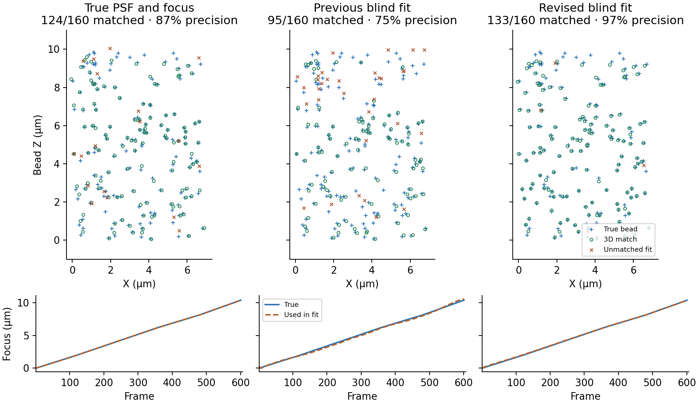

# Recovering beads in a simulated 3D gel

One seeded 64 × 64 pixel gel scan contained 160 freely positioned 40 nm beads, 101 focus stops over a nominal 10 µm, six illumination exposures per stop, XYZ drift and 150 mλ RMS pupil aberration. The generator used 4,500 mean signal photons per bead per exposure before illumination weighting and 5 background photons per pixel. Every run used the same 606-frame TIFF and NVIDIA WebGPU.

The control fixed the seven Noll coefficients and the entire axial focus trace, used the same finite-bead PSF lookup table as the generator, and estimated bead coordinates, brightnesses, background and lateral drift. The blind runs received movie pixels, optical settings and the illumination sequence. Recall and precision below use one-to-one 3D matches within 250 nm in the original simulation coordinates, without registering fitted bead positions to truth.

| Fit | Matches / 160 | Reported beads | Recall | Precision | Pupil coefficient RMSE (mλ) |
|---|---:|---:|---:|---:|---:|
| True generating PSF and focus | 124 | 142 | 77.5% | 87.3% | 0.0 |
| Previous blind fit | 95 | 127 | 59.4% | 74.8% | 28.3 |
| Previous blind fit, two additional rounds | 124 | 132 | 77.5% | 93.9% | 16.7 |
| True generating PSF and focus, corrected seeds | 132 | 138 | 82.5% | 95.7% | 0.0 |
| Corrected initialization, wide table, four rounds | 98 | 135 | 61.2% | 72.6% | 26.3 |
| Revised blind fit, matched table, four rounds | 133 | 137 | 83.1% | 97.1% | 8.4 |
| Revised blind fit, matched table, six rounds | 131 | 137 | 81.9% | 95.6% | 5.2 |

With the true focus trace, 59 isolated detections with a unique nearby lateral neighbour had a median +1.32 µm axial seed error. The simulated PSF reached its strongest smoothed central peak at +1.30 µm defocus. Correcting the modelled peak displacement on all three axes increased initial matches from 2 to 102 of 160 for the same 126 candidates. The final gap includes beads close to the scan boundary, where only part of the through-focus signal is visible.

The initial graph-based focus trace also compressed the first part of this sweep. Long-baseline image separations yielded an estimated step of 103.2 nm. For a scan consistent with steady motion, this initializes a ramp relative to the first plane; the joint fit then varies each plane independently. Large jumps or reversals retain the original image-derived trajectory. The initial pupil patch fit also needs the optical offset: after correction, its coefficient error fell from 74.2 to 20.7 mλ RMS. A common additive Z offset can affect raw bead matches. the example overlay offers an optional shift computed from the two focus traces and displays its size.

The original browser example rendered with a compact table (27 camera pixels across, 0.12 µm axial spacing) and fitted with a wider table sampled at 0.10 µm. With all other initialization and optimizer settings fixed, using the generating grid improved four-round blind matching from 98 to 133. New example TIFFs record only the sampling-grid identifier. The normal upload path reads it and uses the matching vectorial model. Untagged TIFFs use the wide table; sparse image-only fits receive two additional joint rounds. The tagged example uses four rounds, since rounds five and six reduced the pupil error but lost two matches here.

Results are for one simulated field. The seed and focus corrections and additional refinements have not been benchmarked on an experimental gel in this comparison.

Movie SHA-256: `2081158b7a25bfe8ccf90098a37460400e553afbe9ded8c9b7f83bacda873e53`.
